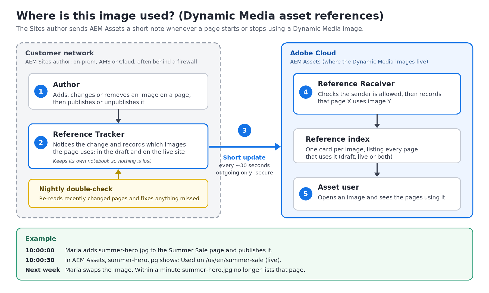

# Where Is This Image Used? (Dynamic Media Asset References)

## In one sentence

When an author puts a Dynamic Media image on a website page, AEM Assets learns about it within about 30 seconds. Anyone looking at the image can then see every page that uses it.

## The problem today

Images live in **AEM Assets**. Websites are built in **AEM Sites**, which is often in the customer's own data center behind their firewall.

When someone in Assets asks "Can I delete or change this image? Where is it used?", the answer today is **wrong or missing**. It depends on website traffic logs that are collected by a slow overnight process, and those logs often can't see inside the customer's network.

## How the new approach works



1. **The author edits a page.** They add, swap or remove an image, then publish or unpublish the page.
2. **The Reference Tracker notices.** This small add-on on the Sites side records which images the page uses, both in the draft and on the live site.
3. **It sends a short update.** About every 30 seconds it sends Assets a note such as "this page now uses these images." The connection only goes **out** from the customer's network, so their firewall rules don't need to change.
4. **The Reference Receiver records it.** On the Assets side, it checks the sender is allowed and updates the index of which pages use which images.
5. **Anyone can look it up.** Open an image and you see the pages using it.

A **nightly double-check** re-reads recently changed pages, so nothing is missed if an update gets lost.

Think of it as a library card system. Every time a book (image) is placed on a shelf (page), a card is filed. When the book moves, the card is updated. Ask about any book and the cards tell you where it is.

## Examples

| What the author does | What Assets shows (within about a minute) |
|---|---|
| Maria adds `summer-hero.jpg` to the *Summer Sale* page and publishes it | `summer-hero.jpg` → *Summer Sale* page, **draft and live** |
| Maria edits the page again but hasn't published yet | Still shows **live**, because the live page hasn't changed |
| Maria replaces the image with `autumn-hero.jpg` and publishes | `summer-hero.jpg` no longer lists the page. `autumn-hero.jpg` does |
| The page is unpublished | The page is still listed, but marked **draft only** (not live) |
| The page is deleted | The page disappears from the image's list |
| The page uses a friendly image name (a "vanity ID") like `summer-hero` instead of the image's internal ID | Assets matches the name to the right image and shows it the same way |

What a user sees when they look up an image:

```
summer-hero.jpg
  • /us/en/summer-sale      live + draft    (site: acme-prod)
  • /uk/en/summer-sale      draft only      (site: acme-prod)
```

## Why this is better

| | Before | Now |
|---|---|---|
| **Speed** | Hours to days | About 30 seconds |
| **Works behind a customer firewall** | Often not | Yes: outgoing only |
| **Shows unpublished drafts** | No | Yes |
| **Needs extra provisioning per customer** | Yes (log storage) | No |

## Frequently asked questions

**Does this slow down authors?**
No. The tracker works in the background after the author saves.

**Is customer data safe?**
Only the page address and the image identifiers are sent. The connection is encrypted and uses a secure access key. Only an approved account can send updates, and people only see references for images they're allowed to open.

**What if the connection is down?**
Updates wait and are re-sent automatically. Nothing is lost.

**Does it change the images themselves?**
No. References are stored separately, so the images are never touched.

**Does it replace the traffic-log reports?**
No. They work together: this approach shows where images are *placed*, and traffic logs show where they're *viewed*, including sites outside AEM.

## Current limits (MVP)

- If an image sits inside a shared block (an **Experience Fragment**) and that block is edited, the pages that use the block update at the nightly double-check, not instantly.
- "Live" means the page was *sent* to the live site. If publishing is stuck, it can show live a little early until the nightly check corrects it.
- For now the results come from a lookup address. They don't yet appear in the Assets screens.

## Glossary

| Term | Meaning |
|---|---|
| **AEM Sites** | Where web pages are built and published |
| **AEM Assets / Dynamic Media** | Where images and videos are stored and delivered |
| **Author / Publish** | Author is the editing workspace. Publish is the live website |
| **Reference** | A record that "page X uses image Y" |
| **Vanity ID** | A friendly name for an image, such as `summer-hero` |
| **On-prem / AMS** | AEM running in the customer's data center, or hosted by Adobe Managed Services |

## For technical readers

Code, setup steps and the API details are in the project [README](../../README.md).

- **Sites side:** event listeners and a background job, with a local record of each page's images.
- **Assets side:** two endpoints:
  - `POST /bin/dmrefs/ingest` receives the updates
  - `GET /bin/dmrefs/references?path=/content/dam/...` looks them up
